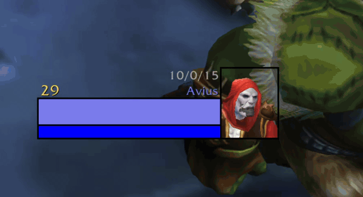
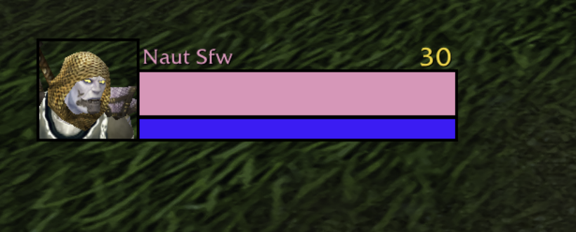
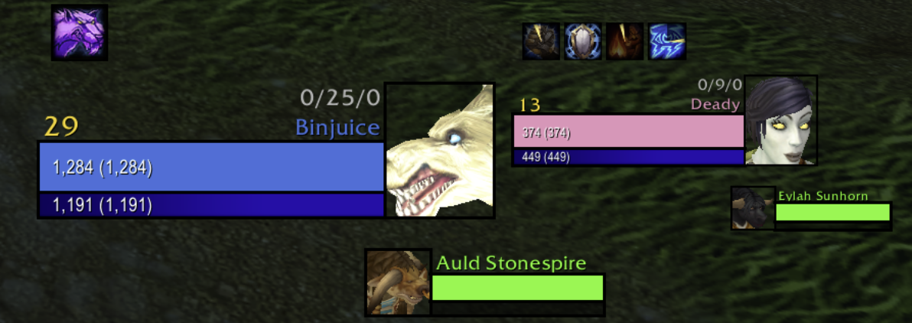

# Living Portraits

Live 3D animated portraits for World of Warcraft unit frames. Your character breathes and idles like on the character screen. A companion addon for [BetterBlizzFrames](https://www.curseforge.com/wow/addons/betterblizzframes).

> Formerly **BBF Animated Portraits**. Upgrading? Delete the old `BBF_AnimatedPortraits` folder from AddOns (if it's still enabled, Living Portraits offers to disable it for you); settings start fresh under the new name. `/bap` still works as an alias for `/lp`.

> **Status:** v0.6.0, public test release. Tested in game on the **WoW Forever beta**, with and without BetterBlizzFrames. See [CHANGELOG](CHANGELOG.md).

## Best with BetterBlizzFrames

Living Portraits works on its own, but it's built to be used with [BetterBlizzFrames](https://www.curseforge.com/wow/addons/betterblizzframes) (BBF), and that's how it looks best.

| | Without BBF | With BBF |
|---|---|---|
| Style | Circle: the model inside Blizzard's round portrait | **Square**: a pixel-bordered box beside the bars (shown below), or circle if you keep BBF's portraits |
| Bars and names | Blizzard's default layout | Resized so the box and bars line up, name and level in one row |
| Extras | None | Talent builds, tall portraits and mirrored target text (square style only) |
| Setup | Nothing to do | One click: **Turn on** in the settings panel (or `/lp bbfsetup`) switches on BBF's Pixel Border mode |

## Screenshots

Switching targets: the bars grow from empty, each player's talent build appears above their name, and every portrait is a live 3D model.



Tall portraits with Mirror Target Text, on BetterBlizzFrames' Pixel Border mode. The player and target frames mirror each other:

| Player | Target and focus |
|---|---|
|  |  |

## How it works

Instead of the flat 2D portrait, a live `PlayerModel` of the unit is drawn in one of two styles:

- **Square** (when BBF's No Portrait / Pixel Border mode is on): a box with BBF's 1px border beside the health and mana bars. The model fills it exactly.
- **Circle** (Blizzard's frames, or BBF with portraits): the model sits behind the frame's border ring, with a soft round edge so its square corners don't show.

If the model can't load (unit out of range or offline), the addon steps aside and the normal portrait shows.

It **never modifies BetterBlizzFrames' files**. BBF is an optional dependency: when installed, this addon loads after it and follows its layout. The only BBF settings it ever changes are the No Portrait + Pixel Border switches, and only when you click **Turn on** (with Undo).

## Install

Download `LivingPortraits-<version>.zip` from the repo's Releases and unzip it into `World of Warcraft/<client>/Interface/AddOns/`.

Or from source:

1. Put this folder in `World of Warcraft/<client>/Interface/AddOns/`. **The folder must be named `LivingPortraits`** to match the `.toc`.
2. `/reload` or log in.

### Developing from a git checkout

Keep the repo elsewhere and symlink it into AddOns under the required name:

```sh
ln -s ~/GitHub/Main/living-portraits \
  "/Applications/World of Warcraft/_classic_beta_/Interface/AddOns/LivingPortraits"
```

(The WoW Forever beta installs into the `_classic_beta_` folder.)

## Settings

Open **Options → AddOns → LivingPortraits** (or type `/lp options`):

- **General:** turn it on/off, hide surnames, square or circle style, and which frames get a living portrait.
- **Camera:** zoom and distance (face size).
- **Target bars:** the grow-from-empty animation (target and focus) and its speed.
- **Square style:** show talent builds, mirror the target text, tall portraits (player, target & focus, party), border color, thickness and opacity, plus box and bar sizing.
- **Circle style:** background, round edge and model size.

The square style needs BetterBlizzFrames' **No Portrait + Pixel Border** mode. The **Turn on** button under *BetterBlizzFrames* switches it on for every frame (your other BBF settings stay as they are) and reloads the UI; **Undo** puts back what you had.

## Commands

`/lp` (or `/livingportraits`; the old `/bap` still works). Everything here is also in the settings panel.

**General**

| Command | Effect |
|---|---|
| `/lp` | Show current settings |
| `/lp options` | Open the settings panel |
| `/lp toggle` | Turn living portraits on/off |
| `/lp unit <group>` | Toggle a frame group: `player`, `target`, `focus`, `tot`, `party` |
| `/lp style square\|circle` | Square box beside the bars (needs BBF's No Portrait / Pixel Border) or round portrait |
| `/lp surname` | First names only (hide surnames) on the player, target, focus, target-of-target and party frames |
| `/lp zoom 0-1` | Camera zoom (1 = head and shoulders, lower = more body) |
| `/lp cam 0.3-2 [large\|small\|square]` | Camera distance (lower = closer, bigger face) |
| `/lp grow` | Toggle the target's and focus's health and mana growing from empty when they change |
| `/lp growtime 0.1-2` | How long the grow takes, in seconds (default 0.35) |
| `/lp bbfsetup` / `/lp bbfundo` | Turn on BBF's No Portrait + Pixel Border mode for every frame / put back your previous BBF settings (reload to apply) |
| `/lp reset` | Restore defaults |

**Square style**

| Command | Effect |
|---|---|
| `/lp build` | Toggle talent builds (points per tree, like `2/8/0`) on the player, target and focus |
| `/lp tall [player\|target\|party]` | Toggle tall portraits per group: a taller rectangle, with the build on its own line above the name on player, target and focus (off: square, build next to the level). Player and target/focus are on by default, party off. No group toggles player + target/focus together |
| `/lp mirror` | Mirror the target and focus text to match the player frame: name and build next to the portrait, level on the outer edge |
| `/lp eliteborder` | Toggle the gold (elite, boss) and silver (rare) portrait border on the target and focus (on by default) |
| `/lp eliteicon top\|bottom\|center\|level\|hidden` | Where the target/focus elite icon goes: the portrait's outer top corner (default), outer bottom corner, bottom center, next to the level, or hidden |
| `/lp bordercolor RRGGBB` | Color of the 1px lines around the portrait box and the bars (default `000000`, black) |
| `/lp bordersize thin\|medium\|heavy` | Thickness of those lines: 1, 2 or 3px (default thin) |
| `/lp borderalpha 0-1` | Opacity of those lines (default 1). Below 1, the box and bars close up so no gap shows where a line was |
| `/lp bg 0-1` | Opacity of the dark background behind the model (default 0 = none) |
| `/lp extend 0-30 [large\|small]` | Make the health + mana stack taller; the box grows with it (default large 10, small 6) |
| `/lp namerow 0-24 [large\|tot\|party]` | Height of the name + level row above the health bar (default large 12, tot 9, party 0) |
| `/lp split 0.4-0.85` | Health bar's share of the stack (default 0.66; mana gets the rest) |
| `/lp alignmana` | Toggle lining up the mana bar with the health bar next to the box |
| `/lp gap 0-20` | Space between the box and the bars (1 = borders share one line) |
| `/lp barspacing 0-10` | Space between health and mana (0 = borders share one line) |

**Circle style**

| Command | Effect |
|---|---|
| `/lp circlebg 0-1` | Opacity of the dark background inside the ring (0 = clear) |
| `/lp vignette` | Toggle the round edge that hides the model's square corners |
| `/lp inset 0.3-1.2 [large\|small]` | Model size relative to the portrait (default 0.80) |
| `/lp calibrate` | Tint the round edge red to line it up with the ring; toggle again to finish |
| `/lp offset <group> x y` | Nudge the portrait inside its ring (groups: player, target, focus, tot, party) |

**Troubleshooting**

| Command | Effect |
|---|---|
| `/lp refresh` | Re-apply the layout now (e.g. after changing BBF settings) |
| `/lp debug [unit]` | Print the frame's real positions, for bug reports (default: target) |
| `/lp grow debug` | Trace the bar grow in chat |

## Known limitations

- **Talent builds** only show for players within inspect range (about 30 yards), and the game may refuse to share enemy players' talents. NPCs never show one.
- **Target-of-target placement:** when the target or focus layout would run into its target-of-target (for example with Edit Mode's small focus frame), the ToT frame is moved down just enough to clear it, and put back when you switch to circle style or turn the addon off.
- **No layout changes in combat:** WoW blocks resizing unit-frame bars mid-fight, so square-style layout changes made in combat (settings, BBF re-layouts) are skipped and apply on the next refresh, such as a target change or `/lp refresh`. That's also why the build line stays reserved on NPC targets.
- **BBF's spec / healer icon portraits** are covered by the 3D model while it shows.

## Feedback

Found a bug or have an idea? Open an issue: https://github.com/nautxx/living-portraits/issues. For layout bugs, `/lp debug target` output plus a screenshot helps a lot.

## Supported clients

| Client | Interface | Status |
|---|---|---|
| WoW Forever beta | 16001 | Supported |
| Retail | 120105 | Not yet |

## Releasing

Day-to-day work happens on `dev`; `main` holds releases.

1. On `dev`: bump `## Version` in the `.toc`, add a `CHANGELOG.md` entry, update the README status, commit and push.
2. Open a PR from `dev` into `main` and merge it with **Create a merge commit** (squash or rebase would make `dev` and `main` diverge).
3. On `main`: tag the merge (`git tag -a v<version> -m "v<version>"`), run `tools/package.sh` to build `dist/LivingPortraits-<version>.zip` (only the files WoW needs), and push the tag.
4. Create the GitHub release from the tag, attach that zip (not GitHub's automatic "Source code" zip, whose folder name WoW won't load), and mark it as a pre-release while testing.
5. Fast-forward `dev` to `main` (`git merge --ff-only main`) so the next PR starts clean.

## License

All Rights Reserved. Copyright (c) 2026 Jason Barnachea (nautxx). See [LICENSE](LICENSE).
Not affiliated with BetterBlizzFrames or Blizzard Entertainment.
